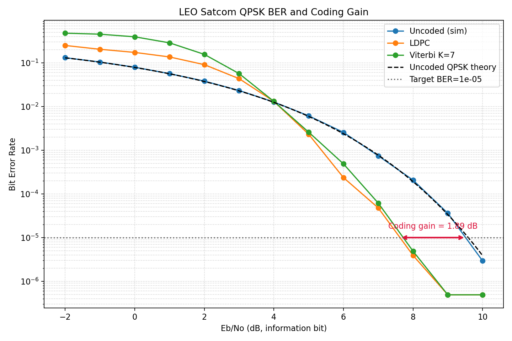
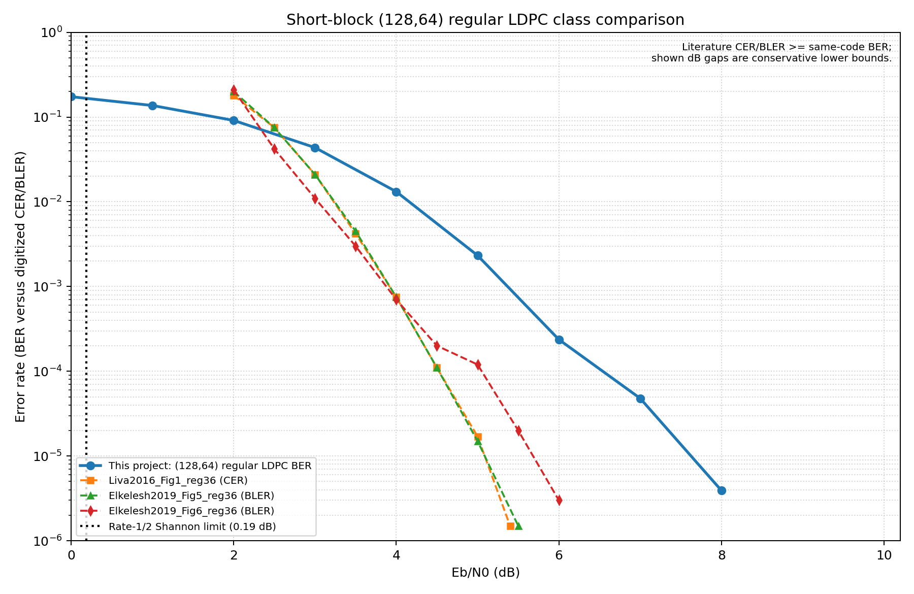

# LEO Uydu Haberleşme Simülasyonu

## Teknik Proje Gelişim ve Sonuç Raporu

**Proje:** `leo-satcom-sim`  
**Platform:** GNU Radio 3.10.12 / Python 3 / Radioconda / Windows  
**Rapor tarihi:** 8 Eylül 2026  
**Kapsam:** Faz 0–6 tasarım, uygulama, kalibrasyon, doğrulama ve sonuçları

---

## 1. Yönetici özeti

Bu çalışma kapsamında, alçak Dünya yörüngesi (LEO) uydu haberleşmesinde
kullanılabilecek bir sayısal taban bant bağlantısı GNU Radio 3.10+ üzerinde
uçtan uca modellenmiştir. Çalışma; verici, LEO kanal etkileri, alıcı
senkronizasyonu, ileri hata düzeltme, BER/EVM ölçümü, Monte Carlo performans
taraması ve literatür karşılaştırmasını kapsayan yedi fazda tamamlanmıştır.

Kurulan sistemin temel iletim yapısı QPSK modülasyonu, RRC darbe
şekillendirme, PN63 çerçeve başlangıcı ve seçilebilir `(128,64)`
`(3,6)-regular` LDPC / `K=7` convolutional-Viterbi kodlamadır. Kanal modeli;
serbest uzay yol kaybı, zamanla değişen Doppler, random-walk faz gürültüsü,
log-normal scintillation ve termal AWGN etkilerini içermektedir. Alıcıda
matched RRC, dördüncü dereceden Costas taşıyıcı döngüsü, Gardner sembol
zamanlama kurtarma ve PN63 tabanlı çerçeve/faz belirsizliği çözümü
uygulanmıştır.

Başlıca doğrulanmış sonuçlar şunlardır:

- Güncel otomatik regresyon sonucu: **30/30 test başarılı**.
- Uncoded QPSK simülasyonunun teorik eğriye en büyük yatay sapması:
  **0,1135 dB**.
- `BER=10^-5` hedefinde uncoded QPSK gereksinimi: **9,5121 dB Eb/No**.
- Aynı hedefte LDPC gereksinimi: **7,6256 dB Eb/No**.
- Elde edilen LDPC kodlama kazancı: **1,8865 dB**.
- Viterbi yolu için `BER=10^-5` kesişimi: **7,7187 dB Eb/No**.
- Düşük SNR faz-belirsizliği kontrolünde en kötü yüksek-BER frame oranı:
  **%1,20**, kabul sınırı **%2**.
- 8 dB senkronizasyon kalite deneyinde 2.000 frame içinde cycle slip:
  **0**.
- Literatür waterfall sınıf-tutarlılığı: **PASS**; en kötü medyan fark
  **1,4889 dB**, tanımlı tolerans **2,0 dB**.

Bu sonuçlara göre proje, araştırma ve algoritma geliştirme amacıyla
tekrarlanabilir bir LEO haberleşme simülasyon altyapısı oluşturma hedefini
karşılamıştır. Bununla birlikte mevcut LDPC matrisi resmi bir CCSDS matrisi
değildir ve BER taraması, kodlama kazancını izole edebilmek amacıyla AWGN
koşulunda yapılmıştır. Bu iki husus, sonuçların operasyonel bir uydu linki
veya standart uygunluk beyanı olarak yorumlanmaması açısından önemlidir.

---

## 2. Projenin amacı ve kapsamı

Projenin amacı, LEO uydu haberleşmesinin fiziksel ve sayısal işaret işleme
etkilerini modüler biçimde temsil eden; farklı kanal, senkronizasyon ve FEC
seçeneklerinin ölçülebilir şekilde karşılaştırılabildiği bir GNU Radio
altyapısı oluşturmaktır.

Çalışma kapsamında aşağıdaki sorulara yanıt aranmıştır:

1. QPSK tabanlı bir uydu verici/alıcı zinciri GNU Radio içinde modüler olarak
   kurulabilir mi?
2. LEO bağlantısına özgü Doppler, faz gürültüsü, scintillation ve termal
   gürültü etkileri tek bir kanal bloğunda temsil edilebilir mi?
3. Taşıyıcı ve sembol zamanlama senkronizasyonu güvenilir şekilde
   gerçekleştirilebilir mi?
4. Kısa blok LDPC ve Viterbi kodlamanın uncoded sisteme göre BER katkısı nedir?
5. Eb/No ölçeği teorik QPSK sonucuyla uyumlu mudur?
6. Elde edilen kısa-blok LDPC performansı benzer kod sınıfındaki yayınlarla
   tutarlı mıdır?

Proje bir link-bütçe veya yörünge analiz yazılımı değildir. Anten kazançları,
EIRP, G/T, gerçek uydu efemerisi, atmosferik gaz/yağmur modeli ve donanım
doğrusal olmayanlıkları mevcut kapsamın dışındadır.

---

## 3. Sistem mimarisi

Uçtan uca işaret akışı aşağıdaki gibidir:

```text
64-bit bilgi blokları
  → LDPC / convolutional encoder / uncoded yol
  → PN63 preamble + codeword + pad
  → differential veya coherent QPSK hazırlığı
  → Gray QPSK mapper
  → interpolating RRC (sps=4)
  → LEO kanal modeli
      ├─ path loss
      ├─ zamanla değişen Doppler
      ├─ random-walk faz gürültüsü
      ├─ log-normal scintillation
      └─ kompleks AWGN
  → matched RRC
  → Costas taşıyıcı senkronizasyonu
  → Gardner timing recovery
  → PN63 frame ve quadrant çözümü
  → LDPC / Viterbi / uncoded karar
  → BER, EVM, lock ve cycle-slip analizi
```

Yazılım; `config`, `tx`, `channel`, `rx`, `analysis`, `data` ve `tests`
katmanlarına ayrılmıştır. Böylece kanal, modem ve ölçüm fonksiyonları birbirine
bağımlı tek bir flowgraph yerine ayrı ayrı test edilebilir hale getirilmiştir.

---

## 4. Kullanılan yöntemler ve seçilme nedenleri

### 4.1 GNU Radio 3.10+

GNU Radio; akış tabanlı DSP mimarisi, hazır haberleşme blokları, Python ile
özel blok geliştirilebilmesi ve QT/GTK tabanlı görsel doğrulama imkânı nedeniyle
seçilmiştir. Kritik zincirler hem `.grc` flowgraph hem de parametrik Python
`top_block/hier_block2` olarak hazırlanmıştır. GRC dosyaları görsel inceleme,
Python sınıfları ise otomatik test ve Monte Carlo çalışmaları için
kullanılmıştır.

### 4.2 Python, NumPy ve SciPy

Python proje orkestrasyonu ve özel GNU Radio blokları için; NumPy vektörel
işaret/bit işlemleri, FFT, BER ve istatistik hesapları için; SciPy ise filtreleme
ve özel kanal süreçleri için kullanılmıştır. Bu seçim, aynı algoritmaların hem
akış zamanında hem de çevrimdışı analizde tekrar kullanılmasını sağlamıştır.

### 4.3 QPSK

QPSK, sembol başına iki bit taşıması, bant verimliliği ve uydu haberleşmesinde
yaygın kullanımı nedeniyle tercih edilmiştir. İdeal constellation noktaları
`(±1,±1)/√2` olarak normalize edilmiş, böylece ortalama sembol enerjisi
`Es=1` yapılmıştır. Bu normalizasyon, teorik Eb/No karşılaştırmasının temelidir.

### 4.4 RRC darbe şekillendirme

TX ve RX tarafında kök yükseltilmiş kosinüs filtre kullanılmıştır:

- örnekleme hızı: `2 MHz`,
- sembol hızı: `500 ksym/s`,
- sembol başına örnek: `4`,
- roll-off: `0,35`,
- tap sayısı: `45`.

RRC, bant sınırlaması ve semboller arası girişimin kontrolü için seçilmiştir.
TX ve RX RRC filtreleri birlikte raised-cosine yanıtı oluşturur. Sonlu filtre
uzunluğundan doğan kazanç farkı ölçülerek RX tapleri, karar örneğinde toplam
kazanç tam `1,0` olacak şekilde normalize edilmiştir.

### 4.5 PN63 preamble

Her frame başında `x^6+x+1` polinomundan üretilen 63-bit m-sequence
kullanılmıştır. PN63 aşağıdaki işlevleri yerine getirir:

- frame başlangıcını korelasyonla bulmak,
- codeword sınırını korumak,
- Costas loop'un `0/90/180/270°` belirsizliğini dört olası rotasyonu
  karşılaştırarak çözmek,
- kayıp veya gürültülü frame sonrasında sabit frame cadence'ini korumak.

### 4.6 LDPC kodlama

Ana FEC yolu olarak `n=128`, `k=64`, rate `1/2`, sütun derecesi `3`, satır
derecesi `6` olan kısa-blok regular LDPC kullanılmıştır. Matris deterministik
seed ile üretilmiş, tam rank olduğu test edilmiştir. Kısa blok boyutu geliştirme,
debug ve Monte Carlo çalışma süresini yönetilebilir tutmak için seçilmiştir.

Önemli kapsam notu: Bu matris **resmi CCSDS 131.0-B-3 matrisi değildir**.
CCSDS ile aynı olduğuna dair bir uygunluk iddiası bulunmamaktadır. Karşılaştırma,
yalnızca aynı `(128,64)` ve `(3,6)-regular` kod sınıfı düzeyindedir.

### 4.7 Viterbi karşılaştırma yolu

İkinci FEC seçeneği olarak rate `1/2`, constraint length `K=7` convolutional
kod ve Viterbi decoder kullanılmıştır. Bu yol, LDPC sonucunun klasik ve yaygın
bir FEC yaklaşımına karşı aynı modem altyapısında değerlendirilmesini
sağlamıştır.

### 4.8 Diferansiyel ve koherent çalışma biçimleri

Gerçekçi yeniden kullanılabilir bağlantı modunda mod-4 diferansiyel kodlama,
Costas loop'un dört katlı faz belirsizliğini doğal olarak gidermek için
kullanılmıştır. Bunun bedeli, bir sembol hatasının komşu diferansiyel kararlara
yayılabilmesidir.

Teorik `0.5·erfc(sqrt(Eb/No))` eğrisi koherent QPSK'yi tanımladığı için BER
performans modu diferansiyel kodlamadan ayrılmıştır. Koherent performans
yolunda gerçek order-4 Costas loop korunmuş, quadrant belirsizliği PN63'ün dört
rotasyonuyla çözülmüştür. Uncoded, LDPC ve Viterbi yolları aynı faz çözümünü
kullanır; böylece karşılaştırma adil tutulmuştur.

### 4.9 Costas ve Gardner döngüleri

QPSK taşıyıcı kurtarma için dördüncü dereceden Costas loop, sembol zamanlama
kurtarma için Gardner TED seçilmiştir. Gardner, veri-yardımsız çalışabilmesi ve
QPSK için uygunluğu nedeniyle tercih edilmiştir.

Genel Costas loop bandwidth değeri ilk `0,02` değerinden `0,005` değerine
indirilmiştir. Bu değişiklik kilitlenme hızından bir miktar ödün vererek
gürültü kaynaklı jitter'ı azaltmıştır. Timing loop bandwidth `0,045` olarak
korunmuştur. Teori-kalibrasyon amaçlı koherent performans yolunda daha dar
`0,0001` Costas bant genişliği kullanılmıştır.

### 4.10 LEO kanal modeli

Kanal modeli tek complex64 giriş/çıkışlı bir `gr.hier_block2` olarak
hazırlanmıştır. Matematiksel olarak:

```text
y[n] = A_scint[n] · x[n] · 10^(-L/20)
       · exp(j·phi_doppler[n]) · exp(j·phi_noise[n]) + w[n]
```

Modelde:

- `path_loss_db`, sabit serbest uzay zayıflamasını,
- `doppler_max_hz` ve profil, LEO geçişi boyunca değişen frekans ofsetini,
- `phase_noise_std`, örnek başına Gauss artımlı random-walk fazı,
- `scintillation_std_db`, yavaş log-normal genlik değişimini,
- `T_sys` ve bant genişliği, `P_N=kTB` termal gürültü gücünü kontrol eder.

Varsayılan fiziksel değerler `T_sys=290 K`, bant genişliği `500 kHz`, maksimum
Doppler `±40 kHz`, scintillation sapması `1 dB`, scintillation bant genişliği
`2 Hz` ve yol kaybı `150 dB` olarak tanımlanmıştır.

### 4.11 Eb/No ve AWGN kalibrasyonu

Birim enerjili QPSK için bilgi biti başına enerji:

```text
Eb = Es / (R · log2(M))
N0 = Es / (R · log2(M) · EbNo)
```

Örnekleme hızındaki toplam kompleks gürültü gücü:

```text
sigma² = N0 · Fs/Rs = sps / (R · 2 · EbNo)
```

Burada QPSK için `log2(M)=2` ve `sps=4` kullanılmıştır. GNU Radio
`noise_source_c` bloğuna `sqrt(sigma²)` genliği verilmiştir. Kompleks toplam
gürültü gücü `sigma²`, I ve Q bileşenlerinin ayrı varyansları ise `sigma²/2`
olmaktadır.

---

## 5. Faz bazında gerçekleştirilen çalışmalar

| Faz | Gerçekleştirilen çalışma | Doğrulama sonucu |
|---:|---|---|
| 0 | Proje dizinleri, merkezi parametre kaynağı, bağımlılıklar ve ortam smoke testi | GNU Radio 3.10+ ve proje modülleri başarıyla doğrulandı |
| 1 | Path loss, Doppler, phase noise, scintillation ve kTB AWGN içeren LEO kanal hierarchy'si | AWGN SNR ve lineer/parabolik Doppler FFT testleri geçti |
| 2 | PN63, `(128,64)` LDPC, differential Gray-QPSK ve TX RRC zinciri | Alist rank/derece, 128-bit encoder çıktısı ve preamble konumu doğrulandı |
| 3 | Matched RRC, order-4 Costas, Gardner timing ve lock detector | Costas varyans trendi, lock ve QPSK uzaklık testleri geçti |
| 4 | Uncoded/LDPC/Viterbi seçilebilir full RX, frame extraction ve EVM | 8 dB LDPC kazancı, EVM monotonluğu ve constellation dengesi doğrulandı |
| 5 | Eb/No kalibrasyonu, cycle-slip/faz belirsizliği analizi ve full BER sweep | Teori sapması 0,1135 dB; 30/30 regresyon başarılı |
| 6 | İki yayınla kısa-blok LDPC sınıf karşılaştırması ve sonuç raporlama | En kötü waterfall medyan ofseti 1,4889 dB; 2 dB sınırında PASS |

---

## 6. Geliştirme sırasında bulunan temel sorunlar ve çözümleri

### 6.1 QPSK ve RRC enerji normalizasyonu

İlk değerlendirmede kullanılan QPSK mapper ve sonlu TX/RX RRC zincirinin gerçek
kazancı, Eb/No formülündeki `Es=1` varsayımıyla uyuşmuyordu. Bunun sonucu olarak
ilk hızlı kontrolde 0 dB BER yaklaşık `0,445` ölçülürken teorik değer yaklaşık
`0,079` idi; yaklaşık 22 dB ölçek/hizalama hatası görülüyordu.

Çözüm olarak QPSK constellation enerjisi doğrudan ölçülerek `Es=1` değerine,
RX RRC tapleri de TX+RX karar kazancı `1,0` olacak şekilde normalize edildi.
Koherent ve diferansiyel performans yolları ayrıldı, frame cadence düzeltildi.
Final full sweep'te teori sapması `0,1135 dB` seviyesine indirildi.

### 6.2 Costas jitter ve kilit metriği

İlk `costas_loop_bw=0,02` ayarı gürültü altında gereğinden fazla jitter
geçiriyordu. Ayrıca ham detector-error varyansı tek başına kilit göstergesi
olarak yeterli değildi. Bandwidth `0,005` değerine indirildi ve sekiz örneklik
gruplu hata ortalaması kullanıldı. Cycle-slip kontrolü, detector error yerine
faz tahminindeki ani quadrant sıçramalarına dayandırıldı.

### 6.3 LDPC decoder giriş metriği ve frame hizalaması

LDPC kazancı ilk tam-zincir testinde beklenen düzeyde değildi. Decoder sentetik
AWGN codeword ile izole edildiğinde doğru çalıştığı görüldü. Kök nedenin alist
veya BP decoder değil, frame kaybı sonrası TX/RX dizi hizalaması ve zayıf hard
metrik olduğu belirlendi.

Frame indeksleri PN konumuna ve mutlak cadence'e bağlandı. LDPC hard karar
güveni `±1` yerine `±3` LLR eşdeğerine çıkarıldı. İzole 8 dB deneyinde:

- decode öncesi BER: `5,9277×10^-3`,
- soft giriş sonrası BER: `1,8984×10^-3`,
- `±3` hard metrik sonrası BER: `1,5625×10^-5`.

### 6.4 Diferansiyel QPSK ile koherent teori uyuşmazlığı

8 dB gerçek RX zincirinde decode öncesi BER'in teoriden yüksek görünmesinin
cycle slip veya acquisition geçişinden kaynaklanmadığı gösterildi. 2.000
frame'de cycle slip görülmedi. Asıl neden, diferansiyel kararların hata yayılımı
ile koherent QPSK teorisinin karşılaştırılmasıydı. Performans ölçümü koherent
moda geçirildi; tekrar kullanılabilir link modu diferansiyel bırakıldı.

### 6.5 Costas quadrant belirsizliği

Koherent modda dördüncü dereceden Costas loop dört olası faza kilitlenebilir.
Başlangıçta üç decoder yolunun tamamında ortak bir çözüm bulunmadığı tespit
edildi. PN63 dört olası dibit rotasyonunda skorlanarak ortak ambiguity resolver
oluşturuldu. Düşük SNR'de tek gürültülü preamble nedeniyle frame silmek yerine
son güvenilir quadrant ve sabit cadence korunmuştur.

---

## 7. Sayısal performans sonuçları

### 7.1 Full Monte Carlo BER taraması

Tarama `-2…10 dB` arasında 1 dB adımla yapılmıştır. Her Eb/No ve decoder yolu
için yaklaşık `1.019.904` geçerli bilgi biti değerlendirilmiştir.

| Eb/No (dB) | Uncoded BER | LDPC BER | Viterbi BER |
|---:|---:|---:|---:|
| -2 | 1,31439×10^-1 | 2,50656×10^-1 | 4,79257×10^-1 |
| -1 | 1,04599×10^-1 | 2,05036×10^-1 | 4,53778×10^-1 |
| 0 | 7,94910×10^-2 | 1,73772×10^-1 | 3,95544×10^-1 |
| 1 | 5,67933×10^-2 | 1,36820×10^-1 | 2,87828×10^-1 |
| 2 | 3,82875×10^-2 | 9,11970×10^-2 | 1,56890×10^-1 |
| 3 | 2,33592×10^-2 | 4,35950×10^-2 | 5,68916×10^-2 |
| 4 | 1,27061×10^-2 | 1,31601×10^-2 | 1,31257×10^-2 |
| 5 | 6,13336×10^-3 | 2,32496×10^-3 | 2,59926×10^-3 |
| 6 | 2,56861×10^-3 | 2,36802×10^-4 | 4,88281×10^-4 |
| 7 | 7,46610×10^-4 | 4,79475×10^-5 | 6,17705×10^-5 |
| 8 | 2,07446×10^-4 | 3,91408×10^-6 | 4,90242×10^-6 |
| 9 | 3,62052×10^-5 | 0 gözlenen hata | 0 gözlenen hata |
| 10 | 2,93556×10^-6 | 0 gözlenen hata | 0 gözlenen hata |

Kodlu yollar yaklaşık 5 dB'den sonra uncoded yoldan belirgin şekilde ayrılmaya
başlamaktadır. Düşük Eb/No bölgesinde kodlu BER'in daha yüksek görünmesi,
Eb/No'nun bilgi biti başına tanımlanması nedeniyle rate-1/2 yoluna iki kat
kompleks gürültü gücü uygulanması ve kısa kodların waterfall altındaki decoder
davranışıyla ilişkilidir. Kodlama her SNR noktasında kazanç sağlamak zorunda
değildir; anlamlı kazanç waterfall bölgesinden sonra ortaya çıkmaktadır.

9 ve 10 dB kodlu sonuçlar “BER sıfırdır” anlamına gelmez. Yaklaşık bir milyon
bit içinde hata gözlenmemiştir; bu noktalar yalnızca sonlu deney için bir güven
üst sınırı verir.

### 7.2 Hedef BER ve kodlama kazancı

Pozitif BER noktaları arasında log-BER doğrusal interpolasyonu uygulanmıştır:

| Yol | `BER=10^-5` için Eb/No |
|---|---:|
| Uncoded QPSK | 9,5121 dB |
| LDPC | 7,6256 dB |
| Viterbi | 7,7187 dB |

LDPC kodlama kazancı:

```text
Gcoding = EbNo_uncoded − EbNo_LDPC
        = 9,5121 − 7,6256
        = 1,8865 dB
```

Bu değer, aynı bilgi BER hedefine ulaşmak için LDPC yolunun uncoded yola göre
yaklaşık `1,89 dB` daha düşük Eb/No ile çalışabildiğini göstermektedir. LDPC ile
Viterbi arasındaki interpolasyon farkı yaklaşık `0,093 dB` olup mevcut deney
çözünürlüğünde sınırlı, ancak LDPC lehinedir.



### 7.3 EVM ve constellation sonuçları

EVM, her senkron sembolün en yakın ideal QPSK noktasına hata vektörü üzerinden
hesaplanmıştır:

```text
EVMrms(%) = sqrt(mean(|error|²) / mean(|ideal|²)) · 100
```

1.000 frame'lik güncel kısa analizden elde edilen değerler:

| Eb/No | Yol | EVM RMS | Decode öncesi BER | Decode sonrası BER |
|---:|---|---:|---:|---:|
| 0 dB | Uncoded | %63,21 | 8,056×10^-2 | 8,056×10^-2 |
| 0 dB | LDPC | %81,84 | 1,605×10^-1 | 1,757×10^-1 |
| 0 dB | Viterbi | %81,76 | 1,604×10^-1 | 3,978×10^-1 |
| 8 dB | Uncoded | %28,17 | 1,564×10^-4 | 1,564×10^-4 |
| 8 dB | LDPC | %39,57 | 6,413×10^-3 | 0 gözlenen hata |
| 8 dB | Viterbi | %39,56 | 6,538×10^-3 | 0 gözlenen hata |
| 10 dB | Uncoded | %22,39 | 0 gözlenen hata | 0 gözlenen hata |
| 10 dB | LDPC | %31,72 | 8,681×10^-4 | 0 gözlenen hata |
| 10 dB | Viterbi | %31,72 | 8,915×10^-4 | 0 gözlenen hata |

Her yol kendi içinde değerlendirildiğinde Eb/No yükseldikçe EVM düzenli olarak
azalmıştır. Aynı bilgi-bit Eb/No'da rate-1/2 kodlu yollara uncoded yolun iki katı
örnek gürültü gücü verildiği için kodlu ve uncoded EVM değerleri doğrudan aynı
kanal-SNR değeri gibi karşılaştırılmamalıdır. Dört constellation kümesinin
sayısal dağılımı dengeli bulunmuştur.

### 7.4 Senkronizasyon ve faz belirsizliği

- Costas hata varyansının başlangıçtan kararlı bölgeye azaldığı doğrulanmıştır.
- 8 dB, no-Doppler kalite deneyinde 2.000 frame içinde cycle slip
  gözlenmemiştir.
- Dört zorlanmış Costas quadrant'ı uncoded, LDPC ve Viterbi yollarında doğru
  çözülmüştür.
- `-2 dB` noktasında `BER>0,3` frame oranları uncoded `%0`, LDPC `%1,20`,
  Viterbi `%0,20`; `0 dB` noktasında üç yol için `%0` bulunmuştur.
- En kötü sonuç tanımlı `%2` kabul sınırının altındadır.

---

## 8. Teori ve literatür karşılaştırması

### 8.1 Uncoded QPSK teorisi

Uncoded koherent Gray-QPSK referansı:

```text
BER = 0,5 · erfc(sqrt(Eb/No))
```

Simülasyon eğrisinin teoriye en büyük yatay sapması `0,1135 dB` ölçülmüştür.
Tanımlanan kabul sınırı `1 dB` olduğundan Eb/No→gürültü gücü dönüşümü, kompleks
I/Q varyans convention'ı ve RRC enerji normalizasyonu başarılı kabul edilmiştir.

### 8.2 LDPC literatür karşılaştırması

Karşılaştırmada aşağıdaki yayınların görsel olarak digitize edilmiş eğrileri
kullanılmıştır:

1. G. Liva ve diğerleri, *Code Design for Short Blocks: A Survey*, Figure 1.
2. Elkelesh ve diğerleri, *Decoder-in-the-Loop: Genetic Optimization-based
   LDPC Code Design*, Figure 5 ve Figure 6.

Waterfall bölgesindeki medyan mutlak Eb/No ofsetleri:

| Referans | Medyan mutlak ofset |
|---|---:|
| Liva2016 Figure 1 `(3,6)-regular` | 1,453 dB |
| Elkelesh2019 Figure 5 `(3,6)-regular` | 1,450 dB |
| Elkelesh2019 Figure 6 `(3,6)-regular` | 1,489 dB |

En kötü sonuç `1,4889 dB < 2,0 dB` olduğundan sınıf-tutarlılığı **PASS** olarak
değerlendirilmiştir. Rate-1/2 için `0,19 dB Eb/No` Shannon kapasite referansı
grafikte teorik alt sınır olarak gösterilmiştir; bu değer mevcut kısa kodun
eriştiği çalışma noktası değildir.

Karşılaştırma birebir kod doğrulaması değildir. H matrisleri, decoder iterasyon
bütçeleri ve metrikler aynı değildir. Yayınlar CER/BLER, proje ise BER raporlar.
Aynı blok için `CER/BLER ≥ BER` olduğundan raporlanan dB farkları doğrudan
BER–BER farkı sayılmamalıdır; mevcut karşılaştırma yalnızca waterfall
konumunun aynı kısa regular-LDPC sınıfıyla makul uyumunu gösterir.



---

## 9. Test ve doğrulama yaklaşımı

Proje yalnızca görsel constellation incelemesine dayandırılmamıştır. Aşağıdaki
alanlarda otomatik testler geliştirilmiştir:

- GNU Radio sürümü ve merkezi parametre importu,
- alist matris rank ve `(3,6)` derece kontrolü,
- LDPC encoder giriş/çıkış uzunluğu,
- PN63 korelasyon konumu,
- kTB tabanlı AWGN SNR doğruluğu,
- lineer ve parabolik Doppler FFT takibi,
- QPSK ve RRC birim enerji kontrolü,
- Costas varyans trendi ve lock detector,
- QPSK EVM ve dört-küme dengesi,
- izole LDPC decoder kazancı,
- tam-zincir LDPC kazancı,
- cycle-slip tespiti,
- dört Costas faz belirsizliğinin üç decoder yolunda çözümü,
- düşük SNR yüksek-BER frame oranı,
- hızlı uçtan uca BER pipeline testi,
- teori interpolasyonu ve gürültü gücü matematiği.

8 Eylül 2026 tarihinde Radioconda GNU Radio ortamında yeniden çalıştırılan
regresyon sonucu:

```text
Ran 30 tests in 9.300s
OK
```

Sonuç: **30/30 test başarılıdır.**

---

## 10. Üretilen temel çıktılar

| Çıktı | Açıklama |
|---|---|
| `channel/leo_channel_model.py` | Parametrik LEO kanal hierarchy'si |
| `tx/tx_chain.py` | LDPC, PN63, QPSK ve RRC verici zinciri |
| `rx/rx_sync_chain.py` | Matched RRC, Costas ve Gardner senkronizasyonu |
| `rx/rx_full_chain.py` | Frame çözümü ve seçilebilir FEC içeren tam alıcı |
| `analysis/ber_sweep.py` | Quick/full Monte Carlo BER taraması |
| `analysis/coding_gain.py` | Hedef BER interpolasyonu ve kodlama kazancı |
| `analysis/evm_calc.py` | RMS EVM, trend ve constellation histogramı |
| `analysis/sync_quality.py` | Cycle-slip ve senkronizasyon kalite analizi |
| `data/ldpc_128_64_regular.alist` | Kullanılan `(128,64)` regular LDPC matrisi |
| `analysis/results/ber_results.csv` | Full BER ham sonuçları |
| `analysis/results/ber_curves.png` | BER ve teori grafiği |
| `analysis/results/coding_gain.txt` | Hedef BER ve coding-gain özeti |
| `analysis/fec_evm_results.csv` | Güncel FEC/EVM kısa analiz tablosu |
| `analysis/results/literature_comparison.png` | Literatür sınıf karşılaştırması |
| `analysis/results/literature_difference.csv` | Digitize referanslarla fark tablosu |

---

## 11. Kısıtlar ve sonuçların doğru yorumlanması

1. **LDPC matrisi resmi CCSDS değildir.** Sonuçlar standart uygunluk veya CCSDS
   performans garantisi olarak sunulmamalıdır.
2. **Full BER sweep AWGN odaklıdır.** Doppler, phase noise, scintillation ve path
   loss tarama sırasında kapatılmıştır. Böylece FEC kazancı izole edilmiştir;
   birleşik LEO kanal performansı ayrıca ölçülmelidir.
3. **Fiziksel link bütçesi tamamlanmamıştır.** Verici gücü, anten kazancı,
   mesafe, pointing loss, atmosfer ve alıcı G/T birlikte modellenmemiştir.
4. **Sıfır gözlenen hata, sıfır BER değildir.** Daha düşük BER iddiaları için
   daha uzun Monte Carlo ve güven aralıkları gereklidir.
5. **Literatür metrikleri birebir aynı değildir.** BER ile CER/BLER ve farklı H
   matrisleri ancak sınıf düzeyinde karşılaştırılmıştır.
6. **Doppler profili parametriktir.** Gerçek TLE/SGP4 yörünge geometrisinden
   hesaplanmamaktadır.
7. **Scintillation fenomenolojik bir modeldir.** AR(1) filtreli log-normal süreç
   kullanılmakta, belirli bir iyonosferik ölçüm kampanyasına fit edilmemektedir.

---

## 12. Önerilen sonraki çalışmalar

1. Operasyonel hedef seçilerek EIRP, anten kazancı, slant range, FSPL, G/T ve
   implementation loss içeren tam link bütçesi kurulmalıdır.
2. TLE/SGP4 tabanlı yörünge geometrisinden gerçek Doppler ve Doppler-rate
   profili üretilmelidir.
3. Kurumsal/standart hedef CCSDS ise resmi CCSDS matrisi ve tanımlı decoder
   koşullarıyla tüm kalibrasyon ve BER deneyleri tekrarlanmalıdır.
4. AWGN, Doppler, phase noise ve scintillation etkilerinin birlikte açık olduğu
   çok-boyutlu performans taraması yapılmalıdır.
5. `BER≤10^-6` bölgesi için daha fazla bit, hata sayısına dayalı durdurma ve
   güven aralığı raporlaması eklenmelidir.
6. SDR veya kayıtlı IQ üzerinden hardware-in-the-loop doğrulama yapılmalıdır.
7. Proje bağımsız Git deposuna alınmalı; kalibrasyon kilometre taşları commit ve
   release etiketiyle izlenmelidir.

---

## 13. Genel sonuç

Faz 0–6 boyunca yürütülen çalışma sonucunda, GNU Radio 3.10+ üzerinde modüler,
parametrik ve otomatik testlerle desteklenen bir LEO uydu haberleşme simülasyon
altyapısı oluşturulmuştur. Sistem; QPSK modem, kısa-blok FEC, çerçeveleme,
taşıyıcı/zamanlama senkronizasyonu, temel LEO kanal bozucuları ve BER/EVM
analizini tek bir doğrulanabilir yapıda birleştirmektedir.

En kritik teknik başarı, Eb/No kalibrasyonunun teorik uncoded QPSK eğrisiyle
`0,1135 dB` içinde uyuşturulmasıdır. Bu doğrulama, raporlanan FEC kazancının
yanlış constellation enerjisi, RRC kazancı veya kompleks gürültü ölçeğinden
kaynaklanmadığını göstermektedir. Kalibre edilmiş full Monte Carlo sonucunda
`(128,64)` regular LDPC yolu, `BER=10^-5` hedefinde uncoded QPSK'ye göre
`1,8865 dB` kazanç sağlamıştır. Viterbi yolu da benzer bölgede iyileşme
göstermiş, ancak LDPC yaklaşık `0,093 dB` daha iyi kesişim vermiştir.

Senkronizasyon tarafında Costas jitter, cycle slip, acquisition geçişi ve
quadrant belirsizliği ayrı ayrı incelenmiştir. Faz çözümünün üç decoder yolunda
ortaklaştırılması ve düşük SNR frame testlerinin geçmesi, BER sonuçlarının gizli
bir 90° kilit hatasıyla bozulmadığını göstermektedir. Güncel 30/30 regresyon
sonucu yazılımın tanımlı kapsam içinde tutarlı çalıştığını doğrulamaktadır.

Literatür karşılaştırması, kullanılan kodun aynı kısa `(3,6)-regular` aileyle
waterfall konumu bakımından 2 dB sınıf toleransı içinde olduğunu göstermiştir.
Ancak mevcut matrisin resmi CCSDS olmadığı ve referansların CER/BLER kullandığı
açıkça korunmalıdır.

Sonuç olarak proje, araştırma, algoritma karşılaştırması ve sonraki
hardware-in-the-loop çalışmalarına temel oluşturabilecek olgunlukta bir
**simülasyon ve doğrulama prototipi** seviyesine ulaşmıştır. Operasyonel sistem
veya standart uygunluk seviyesine geçiş için resmi kod matrisi, gerçek yörünge
verisi, tam RF link bütçesi ve donanım doğrulaması sonraki zorunlu adımlardır.

